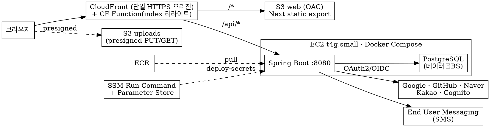

# 계획: 게시판 웹앱 (Next.js · Spring Boot · PostgreSQL · Terraform · AWS)

## Context
빈 디렉토리에서 시작한다(git/backlog 미초기화, 로컬에 java·node·terraform·aws·docker 설치됨).
목표는 **게시판을 뼈대로 다양한 인증·인가와 부가 기능을 덧댄 웹앱**을 만들고, Terraform으로 AWS에 실제 배포하는 것이다.
확장이 가능해야 하므로 기능과 인증 수단을 "하나 추가 = 모듈 하나 추가" 구조로 나눈다.

### 확정된 결정 (유저 선택)
| 영역 | 결정 |
|---|---|
| 백엔드 호스팅 | EC2 1대 + Docker Compose (us-east-1) |
| DB | EC2 안의 PostgreSQL 컨테이너 + 별도 EBS 볼륨 + DLM 스냅샷. 나중에 RDS로 옮길 수 있게 접속 정보는 env로만 받는다 |
| 프론트 | Next.js static export → S3 + CloudFront, Tailwind + shadcn/ui + TanStack Query |
| 도메인 | 지금은 `*.cloudfront.net`. Route53 + ACM은 `domain_name` 변수 하나로 켜게 미리 구현한다(도메인 구입 후 적용) |
| 환경 | prod 1개 + 로컬. Terraform `envs/` 구조로 dev를 나중에 추가할 수 있게 한다 |
| CI/CD | 로컬 `make`와 GitHub Actions가 **같은 scripts/**를 호출한다 |
| 계정 모델 | **통합 계정 1개 + 로그인 수단 N개**(`users` 1:N `user_identities`) |
| 로그인 수단 | 이메일/비번(LOCAL), Google, GitHub, Naver, Kakao, Cognito(OIDC 제공자 중 하나), 휴대폰 OTP(비밀번호 없는 로그인) |
| 자격 발급 | **같은 엔드포인트에서 헤더로 분기**. `Authorization: Bearer`가 있으면 JWT, 없으면 세션 쿠키 + CSRF |
| JWT 범위 | 이번에는 LOCAL과 휴대폰 로그인 API만 JWT를 발급한다. 소셜→JWT(PKCE 토큰 교환)는 후속 작업 |
| 계정 연결 | **로그인한 상태에서만 명시적으로 연결**한다. 이메일이 같아도 자동 병합하지 않는다 |
| SMS | `SmsSender` 인터페이스. prod는 AWS End User Messaging(SNS), 로컬과 테스트는 콘솔/메모리 구현 |
| 부가 기능 | 카테고리/태그 + 검색, 좋아요 + 조회수, 이미지 첨부(S3 presigned), 관리자 화면 |

## 아키텍처

구현할 때는 `diagrams/*.dot`을 원본으로 두고 SVG는 빌드 생성물로 취급한다(CLAUDE.md 다이어그램 원칙).

## 컴포넌트별 역할과 미리 처리할 문제
| 구성 | 역할 | 문제 → 대응 |
|---|---|---|
| CloudFront | `/api/*`는 EC2로, 나머지는 S3로 보낸다 | ① HTTPS 페이지가 HTTP API를 부르면 mixed content가 되고 CORS도 필요해진다 → `/api/*`를 같은 오리진에 둔다. ② `/api/*`에서 쿠키, Authorization 헤더, 쿼리를 전달해야 한다 → CachingDisabled + AllViewerExceptHostHeader. ③ OAuth 콜백(`/api/login/oauth2/code/*`)도 같은 경로로 들어온다. ④ 도메인을 바꾸면 OAuth 콜백 URL을 모든 제공자 콘솔에서 바꿔야 한다 → README 체크리스트에 넣는다 |
| S3 + static export | 정적 서빙 | ① 동적 라우트를 쓸 수 없다 → `/posts/view?id=` 같은 쿼리 라우팅을 쓴다. ② OAC REST 엔드포인트는 하위 index를 자동으로 붙이지 않는다 → `trailingSlash` + CF Function으로 처리한다. ③ middleware를 쓸 수 없다 → 클라이언트 가드(`/api/auth/me`)를 쓰고 권한 판단은 항상 서버가 한다 |
| EC2 | api + pg 실행 | ① 메모리 → t4g.small(2GB) + `MaxRAMPercentage`. ② ARM 이미지 → 로컬 Mac과 GHA `ubuntu-24.04-arm`에서 네이티브로 빌드한다. ③ SSH를 쓰지 않는다 → SSM. ④ 8080은 CloudFront origin-facing prefix list에서만 받는다. ⑤ origin에 DNS 이름이 필요하다 → EIP의 public DNS |
| PostgreSQL | 저장 | 인스턴스를 교체해도 데이터가 남게 별도 EBS + DLM 일간 스냅샷. 스키마는 Flyway로 관리한다. 검색은 PG full-text(`tsvector` + GIN)로 시작한다(한국어 형태소 분석은 후속, 초기에는 `pg_trgm` ILIKE를 보조로) |
| 비밀값 | DB 비번, OAuth client secret, JWT 서명키, Cognito secret | SSM Parameter Store SecureString에 둔다. 배포 스크립트가 EC2에서 `.env`를 만든다. git과 tfstate에는 평문으로 두지 않는다(외부 시크릿은 `aws ssm put-parameter`로 수동 입력하고 README에 목록을 둔다) |
| 업로드 | 이미지 첨부 | 서버가 presigned PUT URL을 발급한다(content-type과 크기 제한, 키는 `uploads/{userId}/{uuid}`). 업로드가 끝나면 첨부를 확정하고, 고아 객체는 S3 lifecycle로 정리한다. 이미지는 CloudFront `/uploads/*` 동작으로 서빙한다 |
| SMS | OTP | ① SMS 샌드박스 해제와 국가별(한국) 발신 등록이 필요하다. 이 부분이 막히는 지점이 될 수 있다 → 앱은 인터페이스 뒤에 두고 로컬과 테스트는 콘솔 구현으로 돌린다. ② 비용과 남용 → 번호와 IP별 발송 레이트리밋 + OTP 시도 5회 제한 + 만료 3분 + 해시 저장 |
| Terraform | IaC | `infra/bootstrap`(state 버킷, `use_lockfile`)과 `infra/main/{modules,envs}`로 나눈다. 모듈은 network, backend_host, frontend_cdn, uploads, cognito, sms, dns_cert(옵션, us-east-1 ACM), ci_oidc |
| CI/CD | 테스트, 빌드, 배포 | 같은 `scripts/*.sh`를 쓴다. GHA는 OIDC로 role을 assume한다. 백엔드는 ECR push → `ssm send-command`로 `compose pull && up -d` → 헬스체크. 프론트는 `s3 sync` → invalidation |
| 로그 | 운영 | Docker `awslogs` 드라이버로 CloudWatch Logs에 보낸다 |

## 인증·인가 설계
```
users(id, nickname, email NULL, phone NULL, role, status, created_at)          -- email/phone은 표시·연락용, 로그인 키 아님
user_identities(id, user_id FK, provider, subject, email, linked_at, UNIQUE(provider, subject))
  provider: LOCAL | GOOGLE | GITHUB | NAVER | KAKAO | COGNITO | PHONE
local_credentials(identity_id PK FK, password_hash)                            -- 비밀번호는 LOCAL에만
otp_challenges(id, phone, code_hash, purpose, attempts, expires_at, consumed_at)
refresh_tokens(id, user_id, token_hash, family_id, expires_at, revoked_at)      -- JWT 로테이션 + 재사용 감지
spring_session*                                                                 -- 웹 세션 (Spring Session JDBC)
```
- **하나의 SecurityFilterChain**에서 Bearer가 있으면 `BearerTokenAuthenticationFilter`(자체 서명 JWT, 짧은 access + refresh 로테이션)를 타고, 없으면 세션을 쓴다. CSRF는 Bearer 요청만 면제한다(`CookieCsrfTokenRepository`, `X-XSRF-TOKEN`).
- **소셜/OIDC**: Spring `oauth2Login`을 쓰고, 제공자별 `OAuth2UserInfo` 매퍼를 둔다(Naver와 Kakao는 응답이 비표준이다). 하는 일은 `IdentityResolver`가 맡는다: (provider, subject)로 identity를 찾으면 로그인하고, 없으면 새 계정을 만든다. 단, **연결 모드**(로그인 상태에서 `/api/me/identities/link/{p}`로 시작)이면 현재 계정에 붙인다. 이 모드는 세션 플래그로 구분한다.
- **휴대폰**: `POST /api/auth/phone/otp`(발송)와 `POST /api/auth/phone/verify`(로그인/가입, 세션 또는 `?token=jwt`). 번호 재활용 대응: 오래 로그인하지 않은 계정에 새 번호 소유자가 들어오는 상황을 막기 위해, 다른 identity가 있는 계정이면 한 번 더 확인한다(예: 기존 수단 중 하나로 재인증하거나 연결을 해제하게 한다). 이 규칙은 비즈니스 규칙(B)으로 명시하고 테스트한다.
- **계정 연결과 해제**: 마지막 identity는 해제할 수 없다(B 규칙).
- **인가**: 역할은 `USER`와 `ADMIN`, 상태 `SUSPENDED`이면 로그인과 쓰기를 거부한다. 수정과 삭제는 작성자 본인 또는 ADMIN만 할 수 있다(`@PreAuthorize` + `OwnershipChecker`). 첫 ADMIN은 env로 지정한 identity로 정한다.
- 확장 포인트: 새 로그인 수단은 `provider` enum, 매퍼 하나, 설정 하나로 추가한다.

## 게시판 도메인 / API
```
categories(id, slug, name)  posts(id, author_id, category_id, title, content, view_count, like_count, search_tsv, created_at, updated_at, deleted_at, hidden_at)
tags(id, name UNIQUE)  post_tags(post_id, tag_id)  post_likes(post_id, user_id, PK(post_id,user_id))
comments(id, post_id, author_id, content, created_at, deleted_at)  attachments(id, post_id NULL, owner_id, s3_key, content_type, size, status)

GET  /api/posts?category&tag&q&sort=latest|popular&page&size     GET /api/posts/{id} (조회수 +1)
POST/PATCH/DELETE /api/posts/{id}           POST/DELETE /api/posts/{id}/like
GET/POST /api/posts/{id}/comments           DELETE /api/comments/{id}
POST /api/attachments/presign → {url,key}   POST /api/attachments/{id}/confirm
GET  /api/categories  GET /api/tags
/api/admin/**: 유저 목록·정지/해제, 글 숨김/복구, 카테고리 관리 (ADMIN)
```
- 조회수 부풀리기 방지: (post, 세션/유저)당 일정 시간 안에는 1회만 센다(B 규칙). like_count는 유니크 제약 + 트랜잭션 안의 카운터로 관리한다.
- 백엔드 패키지: `auth`(identity, local, oauth, phone, jwt), `user`, `post`, `comment`, `like`, `tag`, `attachment`, `admin`, `common`.

## 리포 구조
```
backend/   Gradle Kotlin DSL · Java 25 · Spring Boot 최신 안정판(착수 시 확인)
frontend/  Next.js 최신 안정판 · App Router · output:'export' · TS · Tailwind · shadcn/ui
infra/bootstrap  infra/main/{modules/*,envs/prod.tfvars}
deploy/docker-compose.prod.yml   docker-compose.yml(로컬: pg + 선택적 api)
scripts/{test,build-backend,deploy-backend,deploy-frontend,tf,put-secrets}.sh   Makefile
.github/workflows/{ci.yml,deploy.yml}   diagrams/   .claude-code-agile-hooks.json   backlog/
```

## 진행 방식 (CLAUDE.md 워크플로)
1. 이 계획이 승인되면 `git init`과 `backlog init`을 한다. 위 "확정된 결정"을 `backlog decision`으로 기록한다(호스팅, DB, 같은 오리진, 계정 모델, 세션·JWT 분기, Cognito 역할, 휴대폰 용도, 계정 연결, 도메인 보류).
2. 아래 태스크를 **draft**로 만들어 보여준다. 승인되면 promote하고, `--add-ref decision-N`과 `--doc`으로 결정과 문서를 연결한다. 각 카드에는 `## 비즈니스 규칙`(B<k>)을 적는다.
3. 태스크마다 In Progress로 바꾸고 `task/<ID>` 브랜치에서 작업한다. AC 하나마다 테스트 → 구현 → 커밋. 구현은 서브에이전트(워크트리)에 위임한다.

### Draft 태스크 (순서 = 의존성)
1. 리포 골격 + 로컬 개발환경 + agile-hooks 설정(testCommand, testFirst)
2. 백엔드 기반: 통합 계정 스키마, 단일 보안 체인(세션 + CSRF / Bearer 분기), 인가 공통(역할, 상태, 소유권)
3. 인증: LOCAL 가입·로그인·로그아웃·me + JWT 발급, refresh 로테이션
4. 인증: OAuth2 Google, GitHub (표준) + 계정 연결·해제
5. 인증: Naver, Kakao (비표준 매퍼)
6. 인증: Cognito OIDC (Terraform User Pool + 앱 연동)
7. 인증: 휴대폰 OTP (SmsSender, 레이트리밋, 재활용 번호 규칙)
8. 게시판: 글 CRUD, 페이징, 카테고리/태그
9. 게시판: 댓글, 좋아요, 조회수
10. 게시판: 검색(full-text)
11. 첨부: S3 presigned 업로드와 서빙
12. 관리자 API
13. 프론트: 기반(fetch 래퍼, CSRF, TanStack Query, 가드, 레이아웃) + 인증 화면(모든 수단, 내 계정 연결 관리)
14. 프론트: 게시판 화면(목록, 검색, 상세, 작성, 댓글, 좋아요, 이미지)
15. 프론트: 관리자 화면
16. Terraform: bootstrap, network, EC2(EIP, 데이터 EBS, DLM, SSM role), ECR, S3 web/uploads, CloudFront(+Function), ci_oidc, dns_cert(옵션)
17. 배포 스크립트 + GitHub Actions(ci, deploy) + 시크릿 입력 스크립트
18. 첫 배포, 외부 콘솔 설정(OAuth 콜백, SMS 등록), README, 다이어그램

## 검증
- **백엔드**: JUnit5 + MockMvc + **Testcontainers PostgreSQL**. 보안 매트릭스 테스트를 둔다: (비로그인 / 세션 / Bearer) × (읽기 / 쓰기 / 남의 글) → 200/401/403, CSRF 누락 시 403, Bearer 요청은 CSRF 면제. OAuth는 provider 응답 stub(WireMock)으로 매퍼와 IdentityResolver를 확인한다. OTP는 만료, 시도 제한, 레이트리밋을 테스트한다. `./gradlew test`
- **프론트**: Vitest + Testing Library. `npm run build`로 export 성공을 확인한다
- **로컬 E2E**: compose + next dev(`/api` rewrite) 위에서 Playwright로 LOCAL 가입 → 글/태그/이미지 → 좋아요/댓글 → 다른 계정 403 → 관리자 정지 → 휴대폰 OTP(콘솔 코드)
- **인프라**: `terraform fmt -check`, `validate`, `plan`. apply 후 `https://<cf>/api/actuator/health`와 위 시나리오를 수동 스모크한다(소셜 4개와 Cognito는 실제 콘솔 등록 후 확인)
- **CI/CD**: 로컬 `make deploy`와 GHA deploy 둘 다 성공하는지, 재배포 후에도 데이터가 남는지 확인한다

## 리스크 / 비용
- 리스크: 한국행 SMS 발신 등록 지연, cloudfront.net 도메인에서 일부 OAuth 제공자 콜백 등록 제약 가능성(막히면 도메인 구입을 앞당긴다), 범위가 크다(태스크 18개).
- 비용(대략 월): t4g.small 약 $12, EBS 약 $2, EIP IPv4 약 $3.6. CloudFront, S3, ECR, Cognito(소규모 MAU)는 거의 0. SMS는 건당 과금. 정리는 `terraform destroy`로 한다.
