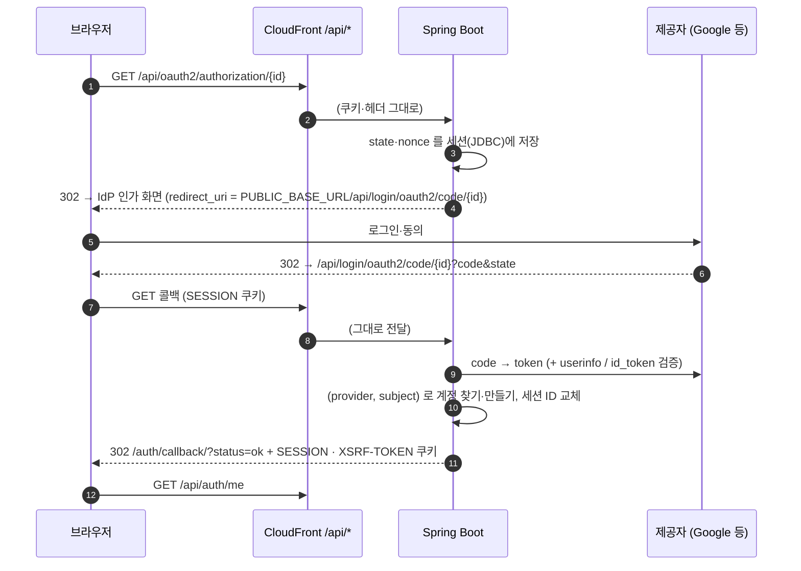

# 백엔드 API 레퍼런스

Spring Boot API의 상세 규칙이다. 모든 경로는 `/api` 아래에 있다(`server.servlet.context-path=/api`). 오류는 JSON `{"status","error","message"}`이다.
개요와 실행 방법은 [README](../README.md)에 있다. 이 문서는 TASK-18에서 README의 API 절을 옮긴 것이다.

- [오류 응답](#오류-응답-task-20) · [인증·인가 모델](#인증인가-모델-백엔드) · [인증 API (LOCAL)](#인증-api-local) · [휴대폰 OTP](#휴대폰-otp-로그인-task-7) · [소셜 로그인·계정 연결](#소셜-로그인-google--github--naver--kakao--cognito-과-계정-연결)
- [게시판](#게시판-api-task-8) · [댓글·좋아요·조회수](#댓글--좋아요--조회수-task-9) · [검색](#검색-task-10) · [이미지 첨부](#이미지-첨부-task-11) · [관리자](#관리자-api-task-12)
- 콘솔 설정: [oauth-setup.md](oauth-setup.md), [sms-setup.md](sms-setup.md)

## 오류 응답 (TASK-20)

모든 오류 응답은 `Content-Type: application/json`이고 본문은 `{"status", "error", "message"}`이다. 입력 검증 오류는 `fields`(필드·파라미터 이름 → 메시지)가 더 붙는다. `error`는 snake_case 코드이고, `message`는 화면에 그대로 보여도 되는 한국어 문장이다. 스택트레이스나 내부 예외 메시지는 응답에 넣지 않는다(서버 로그에만 남긴다).

| 상태 · `error` | 언제 |
|---|---|
| 400 `validation` | 본문 필드 검증 실패, 필수 파라미터 누락. 본문 문자열·쿼리 파라미터에 제어 문자(U+0000–U+001F 중 탭·LF·CR 제외, U+007F–U+009F)가 있을 때도 같다. DB가 데이터 오류(SQLState 22xxx)로 거부한 값도 400 `validation` |
| 400 `validation` (본문) | 요청 본문의 알 수 없는 필드(오타 PATCH가 조용히 무시되지 않는다), 필드 타입 오류. `fields`의 키는 본문 경로다(예: `titel`, `sortOrder`, `attachmentIds[1]`) |
| 400 `bad_request` | 본문이 JSON 문법에 맞지 않거나 비었다(특정 필드 탓이 아님) |
| 409 `conflict` | 앞단 검사를 지나 DB 제약(유니크 등)에 걸렸고 엔드포인트 고유 코드(예: `email_taken`, `slug_taken`)가 없을 때 |
| 401 `unauthorized` · 403 `forbidden`·`csrf`·`suspended`·`step_up_required` | 보안 체인(아래 인증·인가 모델) |
| 404 `not_found` | 없는 경로(인증된 요청. 익명은 먼저 401) |
| 405 `method_not_allowed` | 경로는 있지만 메서드가 다르다. `Allow` 헤더가 붙는다 |
| 406 `not_acceptable` | `Accept`가 JSON을 받지 않는다(본문은 그래도 JSON) |
| 415 `unsupported_media_type` | 본문이 `application/json`이 아니다 |
| 500 `internal_error` | 처리되지 않은 서버 오류 |
| 그 밖의 상태 | 필터·컨테이너에서 난 오류(`/api/error`)는 상태 이름의 snake_case(예: 503 `service_unavailable`) |

엔드포인트별 고유 코드(예: `email_taken`, `post_not_found`)는 각 절에 있다.

## 인증·인가 모델 (백엔드)

<!--dot:auth-model-->
<p align="center"></p>
<!--/dot:auth-model-->

- **계정**: `users` 1 : N `user_identities(provider, subject)`. 비밀번호는 `local_credentials`에만 있다(decision-4).
- **하나의 보안 체인**(decision-5): `Authorization: Bearer <JWT>`가 있으면 JWT로 인증하고 세션은 읽지도 쓰지도 않는다.
  없으면 `SESSION` 쿠키(Spring Session JDBC, HttpOnly·SameSite=Lax)로 인증한다. 토큰이 틀리면 세션이 있어도 401.
- **CSRF**: 세션 요청의 POST/PUT/PATCH/DELETE는 `XSRF-TOKEN` 쿠키 값을 `X-XSRF-TOKEN` 헤더로 보내야 한다.
  SPA는 처음에 `GET /api/auth/csrf`로 쿠키를 받는다. Bearer 요청은 CSRF 면제.
- **오류**: 미인증 401, 권한 없음 403, 모두 JSON(`{"status","error","message"}`). 로그인 페이지 리다이렉트는 없다.
- **인가**: 기본은 인증 필요. 역할 `USER`/`ADMIN`은 `@PreAuthorize`, 수정·삭제는 `@ownership.canModify(authentication, ownerId)`
  (본인 또는 ADMIN). `SUSPENDED` 계정은 읽기만 되고 모든 쓰기가 403(DB 최신 상태 기준, 보안 체인에서 공통 처리).
- **제한 세션**(재활용 번호 보호, 아래 휴대폰 로그인): 읽기만 되고 쓰기는 403 `step_up_required`(로그아웃·step-up·로그인 계열 제외).
- `/api/actuator/health`는 공개, 세부 정보(DB 등)는 ADMIN에게만.

### 인증 API (LOCAL)

| 요청 | 설명 |
|---|---|
| `POST /api/auth/signup` `{email, password, nickname}` | 201 + 사용자 요약. 자동 로그인 없음. 비밀번호 8자 이상·72바이트 이하·문자+숫자, 닉네임 2~20자. 같은 이메일(대소문자 무시) 중복은 409. CSRF 필요 |
| `POST /api/auth/login` `{email, password}` | 세션 로그인: 세션 ID 교체 + `SESSION` 쿠키 + 새 `XSRF-TOKEN` 쿠키, 200 + 사용자 요약. CSRF 필요 |
| `POST /api/auth/login?token=jwt` | 세션 없이 `{accessToken, refreshToken, tokenType:"Bearer", expiresIn}`. CSRF 면제(쿠키를 만들지 않는 비브라우저 흐름) |
| `POST /api/auth/token/refresh` `{refreshToken}` | 로테이션: 새 access+refresh. 이미 쓴 refresh를 다시 쓰면 그 로그인(family)의 토큰을 모두 폐기하고 401. Authorization 헤더 없이 호출. CSRF 면제 |
| `POST /api/auth/logout` | 세션: 세션 삭제 + 쿠키 만료(CSRF 필요). Bearer: 본문 `{refreshToken}`이 있으면 그 family 폐기. 항상 204, 정지 계정도 가능 |
| `GET /api/auth/me` | 현재 사용자 `{id, nickname, email, role, status, providers, stepUpRequired, stepUpProviders}` (DB 최신 값). 익명은 401. `stepUpRequired`면 이 세션·토큰은 제한 상태이고 `stepUpProviders`는 다시 인증할 수 있는 수단 |

- 로그인 실패는 이유와 상관없이 같은 401(`invalid_credentials`)이다. 정지 계정은 비밀번호가 맞을 때만 403(`suspended`).
- refresh 토큰은 256비트 랜덤 값이고 DB에는 SHA-256 해시만 둔다. access 토큰은 상태가 없어 로그아웃 뒤에도 만료(15분)까지 유효하다.

### 휴대폰 OTP 로그인 (TASK-7)

번호 + 인증번호로 하는 비밀번호 없는 로그인·가입이다(provider=`PHONE`, subject=E.164 번호, decision-7).

| 요청 | 설명 |
|---|---|
| `POST /api/auth/phone/otp` `{phone}` | 202 `{challengeId, expiresIn:180}` + 6자리 인증번호 SMS. 계정이 있든 없든 같은 응답. 공개, CSRF 필요(Bearer는 면제) |
| `POST /api/auth/phone/verify` `{challengeId, code}` | 맞으면 (PHONE, 번호) 계정으로 로그인, 없으면 새 계정(+ `users.phone`). 세션 로그인(세션 ID 교체 + 쿠키), 200 + 사용자 요약. CSRF 필요 |
| `POST /api/auth/phone/verify?token=jwt` | 세션 없이 access+refresh. CSRF 면제(`login?token=jwt`와 같은 이유) |
| `POST /api/auth/phone/verify?link=true` | (로그인 필요, 세션·Bearer) 현재 계정에 PHONE 연결 + 비어 있으면 `users.phone`, 200 + 사용자 요약. 다른 계정의 번호면 409 `identity_in_use`. 세션이면 CSRF 필요(`token`과 같이 쓸 수 없다) |
| `POST /api/auth/step-up/local` `{password[, refreshToken]}` | (로그인 필요) 제한 세션·토큰을 비밀번호로 풀기. 세션: 세션 ID를 바꾼 제한 없는 세션. Bearer: 제한 없는 새 토큰(본문 refreshToken의 family 폐기). 틀리면 401 `invalid_credentials`, LOCAL이 없으면 400 `step_up_unavailable` |

- 번호는 libphonenumber로 E.164로 정규화한다(`+` 없으면 `SMS_DEFAULT_REGION`=KR). 형식이 틀리면 400 `invalid_phone`.
- 인증번호는 SecureRandom 6자리이고 DB(`otp_challenges`)에는 HMAC-SHA256(`OTP_HASH_KEY`, 챌린지 id·번호·코드)만 둔다.
  **3분** 뒤 만료되고, 한 번 성공하면 소멸한다(재사용 불가). 틀린 시도가 **5번**이 되면 챌린지를 폐기한다(그 뒤에는 맞는 코드도 실패).
  시도 횟수는 챌린지 행을 잠그고(FOR UPDATE) 세므로 동시 요청에도 정확하다.
- 검증 실패(틀린 코드, 없음·만료·소멸·폐기된 챌린지)는 모두 같은 401 `invalid_otp`. 정지 계정은 403 `suspended`.
- **발송 한도**(DB 기준이라 인스턴스가 여러 개여도 같다): 같은 번호 60초에 1회·24시간 10회(`OTP_PHONE_DAILY_LIMIT`), 같은 클라이언트 IP
  1시간 20회(`OTP_IP_HOURLY_LIMIT`). 넘으면 429 `rate_limited` + `Retry-After`(초). SMS 발송 실패는 503 `sms_unavailable`.
- **클라이언트 IP**: CloudFront 뒤에서는 EC2가 CloudFront의 IP를 보므로 `CLIENT_IP_HEADER=CloudFront-Viewer-Address`로 두고
  그 값(`ip:port`)의 IP를 쓴다. 헤더가 없거나 형식이 틀리면 remote address. `X-Forwarded-For`는 쓰지 않는다(클라이언트가 위조 가능).
  CloudFront 오리진 요청 정책이 `CloudFront-Viewer-Address`를 넘겨야 하고, EC2는 CloudFront를 거친 요청만 받아야 한다(TASK-16).
- **재활용 번호 보호**: 번호는 해지 후 다른 사람에게 다시 배정될 수 있다. 그래서 PHONE 말고 다른 수단(LOCAL·소셜·Cognito)도 있는
  계정에 PHONE으로 로그인하면 **제한 세션·토큰**(`stepUpRequired=true`, JWT 클레임 `step_up_required`, refresh로 받은 토큰도 유지)이다.
  읽기는 되지만 쓰기는 403 `step_up_required`이고, 로그아웃·step-up·다른 로그인만 된다. 수단 연결(`?link=true`,
  `/api/me/identities/link/{p}`)과 해제도 막힌다. 풀려면 기존 수단으로 다시 인증한다: LOCAL은 `POST /api/auth/step-up/local`,
  소셜·Cognito는 그 수단으로 다시 로그인(`/api/oauth2/authorization/{p}`) — 같은 계정으로 들어오므로 제한 없는 새 세션이 된다.
  PHONE만 있는 계정은 제한하지 않는다.
- **SMS 설정**: 로컬은 `SMS_PROVIDER=console`(기본) — 인증번호가 백엔드 로그에 `[SMS console] to=... message=...`로 찍힌다.
  운영은 `SMS_PROVIDER=aws` + `SMS_AWS_REGION`(+ `SMS_ORIGINATION_IDENTITY`). AWS End User Messaging SMS
  (`pinpoint-sms-voice-v2` `SendTextMessage`, 메시지 유형 TRANSACTIONAL)를 EC2 인스턴스 프로파일 자격으로 부른다 —
  IAM에 `sms-voice:SendTextMessage`가 필요하다. 샌드박스 해제와 한국행 발신 등록(발신 번호·sender ID)은 콘솔 작업이다 — [sms-setup.md](sms-setup.md).

### 소셜 로그인 (Google · GitHub · Naver · Kakao · Cognito) 과 계정 연결

브라우저 내비게이션 흐름이다(fetch가 아니라 `location.href`로 이동한다). 모든 리다이렉트는 `PUBLIC_BASE_URL` 기준 절대 URL이다.

| 요청 | 설명 |
|---|---|
| `GET /api/oauth2/authorization/{google\|github\|naver\|kakao\|cognito}` | 로그인 시작 → 제공자 인가 화면으로 302. state·nonce는 세션(Spring Session JDBC)에 저장 |
| `GET /api/login/oauth2/code/{google\|github\|naver\|kakao\|cognito}` | 제공자 콜백. 성공: 세션 ID 교체 + `SESSION`·새 `XSRF-TOKEN` 쿠키 + 302 `/auth/callback/?status=ok`. 실패: 302 `/auth/callback/?error=<코드>` |
| `GET /api/me/identities/link/{google\|github\|naver\|kakao\|cognito}` | (로그인 필요, 세션 전용) 현재 계정에 연결 시작. 콜백 뒤 302 `/account/?linked=<제공자>` 또는 `/account/?error=<코드>` |
| `GET /api/me/identities` | 내 로그인 수단 `[{id, provider, email, linkedAt}]` |
| `DELETE /api/me/identities/{id}` | 해제, 204. 남의 것 404, 마지막 하나는 409 `last_identity`. LOCAL을 해제하면 비밀번호도 지운다. CSRF 필요 |

- 처음 보는 (제공자, subject)면 새 계정을 만든다. **이메일이 같아도 기존 계정에 합치지 않는다**(decision-8). 합치려면
  기존 계정으로 로그인한 뒤 "연결"한다. 이미 다른 계정에 붙은 수단은 연결할 수 없다(`identity_in_use`).
- 새 계정의 닉네임은 제공자 이름(GitHub는 이름이 없으면 login)을 2~20자로 정리한 값, `users.email`은 제공자가 검증한
  이메일일 때만 채운다(GitHub 공개 이메일은 검증된 주소로 본다. 비공개면 비어 있다). email은 표시·연락용이고 로그인 키가 아니다.
  - Naver: subject=`response.id`, 닉네임은 별명 → 이름. 이메일은 검증 여부 필드가 없지만 네이버 기본 이메일 또는 인증을 거친
    연락처 이메일이라 검증된 것으로 본다(미동의면 비어 있다).
  - Kakao: subject=숫자 `id`, 닉네임은 `kakao_account.profile.nickname` → `properties.nickname`. 이메일은 선택 동의라 없어도
    가입된다(`users.email`·identity email 모두 null). `is_email_valid`와 `is_email_verified`가 모두 true일 때만 기록한다.
  - Cognito(OIDC): subject=`sub`, 닉네임은 `name` → `preferred_username` → `given_name` → 이메일 앞부분. `email_verified`는
    boolean 또는 문자열 `"true"`(Cognito userinfo) 모두 받는다.
- 실패 코드: `access_denied`(사용자가 거부), `authorization_request_not_found`(state 없음·만료·재사용), `invalid_id_token`,
  `invalid_nonce`, `invalid_grant`, `invalid_token_response`(토큰 응답에 access_token 없음 — Naver 토큰 오류), `invalid_user_info_response`, `invalid_user_info`(제공자 응답에 id 없음), `unknown_provider`(설정 안 된 제공자), `suspended`,
  연결 전용 `identity_in_use`, `link_expired`(연결 시작 10분 초과 또는 그 사이 다른 계정으로 바뀜).

OAuth 로그인 흐름(시퀀스라 DOT 대신 mermaid로 그렸다):



**제공자 콘솔 설정**(단계별 절차와 확인 체크리스트는 [oauth-setup.md](oauth-setup.md)) — Authorized redirect URI(callback URL)에 다음을 그대로 넣는다(`PUBLIC_BASE_URL`이 바뀌면 모든 콘솔에서 바꾼다):

```
${PUBLIC_BASE_URL}/api/login/oauth2/code/google   # Google Cloud Console → OAuth 클라이언트 ID(웹 애플리케이션)
${PUBLIC_BASE_URL}/api/login/oauth2/code/github   # GitHub → Settings → Developer settings → OAuth Apps
${PUBLIC_BASE_URL}/api/login/oauth2/code/naver    # Naver Developers → 애플리케이션 → API 설정 → 네이버 로그인 Callback URL
${PUBLIC_BASE_URL}/api/login/oauth2/code/kakao    # Kakao Developers → 앱 → 카카오 로그인 → Redirect URI
${PUBLIC_BASE_URL}/api/login/oauth2/code/cognito  # Terraform cognito 모듈이 App Client callback_urls 로 등록(콘솔 작업 없음)
```

- **Naver**: Naver Developers에서 애플리케이션 등록(사용 API: 네이버 로그인). "제공 정보 선택"에서 별명(또는 이름)과 이메일을
  고른다(scope는 보내지 않고 이 설정을 따른다). 서비스 URL은 `PUBLIC_BASE_URL`. 검수 전에는 등록한 테스터 아이디만 로그인된다.
  토큰 요청은 client_id·client_secret을 파라미터로 보낸다(`client_secret_post`).
- **Kakao**: Kakao Developers에서 앱 생성 → 플랫폼(Web) 사이트 도메인에 `PUBLIC_BASE_URL` 등록 → 카카오 로그인 활성화 →
  Redirect URI 등록 → 보안에서 Client Secret 사용(코드 받아 `KAKAO_CLIENT_SECRET`, `client_secret_post`). `KAKAO_CLIENT_ID`는
  **REST API 키**. 동의 항목에 닉네임(`profile_nickname`)과 카카오계정 이메일(`account_email`, 선택 동의)을 설정한다 — 앱은
  `scope=profile_nickname,account_email`을 요청하므로 둘 중 하나라도 설정돼 있지 않으면 Kakao가 KOE205로 거부한다. 이메일
  동의 항목은 비즈 앱 전환이 필요할 수 있다.
- **Cognito**(decision-6, OIDC 제공자 하나로 취급): `infra/main/modules/cognito`가 User Pool(이메일 로그인·검증), secret이 있는
  App Client(code flow, `openid email profile`, 콜백 `${public_base_url}/api/login/oauth2/code/cognito`), Hosted UI 도메인을 만든다.
  출력 → env: `client_id` → `COGNITO_CLIENT_ID`, `client_secret`(sensitive, `terraform output -raw client_secret`) →
  `COGNITO_CLIENT_SECRET`, `issuer_uri`(`https://cognito-idp.<region>.amazonaws.com/<pool id>`) → `COGNITO_ISSUER_URI`,
  `domain_url`(`https://<prefix>.auth.<region>.amazoncognito.com`) → `COGNITO_DOMAIN`. 앱은 issuer 디스커버리를 하지 않고
  Hosted UI 도메인의 `/oauth2/authorize`·`/oauth2/token`·`/oauth2/userInfo`와 `<issuer>/.well-known/jwks.json`을 직접 쓴다
  (Cognito 없이도 앱이 뜬다). 사용자는 Hosted UI(관리형 로그인 페이지)에서 가입·이메일 인증·로그인한다. 로컬에서 시험하려면
  모듈의 `callback_urls`에 `http://localhost:3000/api/login/oauth2/code/cognito`를 더한다(Cognito는 localhost만 http 허용).

로컬 개발은 `PUBLIC_BASE_URL=http://localhost:3000`(Next 개발 서버가 `/api`를 백엔드로 프록시)이라 콘솔에도
`http://localhost:3000/api/login/oauth2/code/{google|github|naver|kakao|cognito}`를 등록한다. 프론트 프록시 없이 백엔드만 시험할 때는
`PUBLIC_BASE_URL=http://localhost:8080`으로 두고 그 주소의 콜백을 등록한다. 앱이 CloudFront 뒤에 있어 요청 Host로는 공개 주소를
알 수 없으므로 redirect-uri를 설정값으로 고정한다. client id/secret이 없는 제공자는 등록하지 않으며 앱은 그대로 뜬다.
새 제공자는 `OAuth2UserInfoMapper` 빈 하나와(Naver·Kakao가 비표준 응답 예시, Cognito가 설정으로 엔드포인트를 만드는 예시) `app.oauth2.registrations.<id>.*` 설정으로 붙인다.

## 게시판 API (TASK-8)

글 목록·상세·카테고리·태그 읽기는 공개(익명 가능)다. 쓰기는 로그인이 필요하고, 세션이면 CSRF 토큰도 필요하다. 정지 계정과 제한 세션의 쓰기는 공통 필터가 403으로 막는다.

| 요청 | 설명 |
|---|---|
| `GET /api/posts?category=<slug>&tag=<name>&q=<검색어>&page=0&size=20&sort=latest` | `{items:[{id, title, excerpt, author:{id, nickname}, category:{id, slug, name}\|null, tags, createdAt, updatedAt, deleted, hidden, likeCount, viewCount}], page, size, totalElements, totalPages}`. 오프셋 페이징. `size` 1~50(기본 20), `page` ≥ 0. `sort`는 `latest`(기본, `created_at`·`id` 내림차순)와 `popular`(TASK-9: `like_count` 내림차순, 같으면 최신순)만 받고 대소문자는 가리지 않는다. 범위를 벗어나거나 형식이 틀리면 400. `tag`는 태그와 같은 규칙으로 정규화한다. `excerpt`는 공백을 접은 본문 앞 200자이고, 잘렸으면 끝에 `…`를 붙인다 |
| `GET /api/posts/{id}` | `{id, title, content, author, category, tags, createdAt, updatedAt, editable, deleted, hidden, likeCount, likedByMe, viewCount, attachments}`. `attachments`는 붙은 이미지 `[{id, url, contentType, size, status}]`(올린 순, 아래 TASK-11). `editable`은 보는 사람이 작성자나 ADMIN이고 글이 삭제되지 않았을 때 true. `likedByMe`는 보는 사람이 좋아요를 눌렀는지(익명은 false). 조회수를 올린다(아래 TASK-9). 없으면 404 `post_not_found` |
| `POST /api/posts` `{title, content, categorySlug?, tags?, attachmentIds?}` | 201 + `Location` + 상세. `attachmentIds`(최대 10)는 본인이 올려 확정한 첨부(아래 TASK-11). 제목은 1~100자, 본문은 1~20000자이고 둘 다 공백만으로는 쓸 수 없다(어기면 400 `validation`). 없는 카테고리는 400 `unknown_category` |
| `PATCH /api/posts/{id}` | 보낸 필드만 바꾼다(빠진 필드나 null은 그대로 둔다). `categorySlug:""`는 카테고리를 빼고, `tags:[]`는 태그를 모두 지운다. `attachmentIds`는 첨부 목록을 통째로 바꾸고(빠진 첨부는 연결 해제), `[]`는 모두 뗀다. 200 + 상세 |
| `DELETE /api/posts/{id}` | soft delete(`deleted_at`). 204 |
| `GET /api/categories` | `[{id, slug, name, sortOrder, adminOnly}]`(sort_order 순). 기본 카테고리는 `notice`(공지, ADMIN 전용)와 `free`(자유게시판) |
| `GET /api/tags?q=<접두어>&limit=20` | `[{name, postCount}]`. 보이는 글에 붙은 태그만, 글 수 내림차순(같으면 이름순)이다. `q`는 소문자와 공백을 정규화한 접두어이고 `%`·`_`도 글자 그대로 비교한다. `limit`은 1~100 |

- **수정·삭제 권한(B1)**: 작성자와 ADMIN만 할 수 있다. `@PreAuthorize("@ownership.canModify(authentication, @postService.ownerOf(#id, authentication))")`로 검사하며, 글이 없거나 이미 삭제됐으면 404를 먼저 낸다. 숨긴 글은 ADMIN이 아니면 없는 글처럼 404다. 그다음 남의 글이면 403 `forbidden`이다. 삭제된 글은 ADMIN도 수정할 수 없다(복구는 TASK-12).
- **삭제·숨김 글(B2)**: ADMIN이 아니면 목록에 나오지 않고 상세는 404다. ADMIN은 상세에서 `deleted`·`hidden` 표시와 함께 볼 수 있고, 목록은 `?includeHidden=true`를 붙였을 때만 포함한다(ADMIN이 아니면 이 파라미터는 무시한다).
- **태그(B3)**: 이름은 NFC로 정규화한 뒤 앞뒤 공백을 지우고, 안쪽 공백을 한 칸으로 줄이고, 소문자로 바꾼다. 30자를 넘거나 비면 400 `invalid_tag`다. 한 글 안의 중복은 하나로 합치며, 합친 뒤 5개를 넘으면 400 `too_many_tags`다(입력 배열은 20개까지 받는다). 태그는 `INSERT ... ON CONFLICT (name) DO NOTHING`으로 넣은 뒤 다시 읽어서 재사용하므로, 같은 새 태그를 동시에 써도 행은 하나만 생긴다.
- **ADMIN 전용 카테고리**: `categories.admin_only=true`인 카테고리(공지)에 글을 쓰거나 글을 옮기는 것은 ADMIN만 할 수 있다. USER는 403 `category_admin_only`를 받는다.

### 댓글 · 좋아요 · 조회수 (TASK-9)

댓글 목록은 공개다. 댓글 작성·삭제와 좋아요·취소는 로그인이 필요하고, 세션이면 CSRF 토큰도 필요하다. 정지 계정과 제한 세션은 403(`suspended`·`step_up_required`)이다.

| 요청 | 설명 |
|---|---|
| `GET /api/posts/{id}/comments?page=0&size=20` | `{items:[{id, postId, content, author:{id, nickname}, createdAt, updatedAt, deleted, editable}], page, size, totalElements, totalPages}`. 오래된 순(`created_at`·`id` 오름차순). `size` 1~100(기본 20). 글이 없거나 보는 사람에게 보이지 않으면(삭제·숨김, ADMIN 제외) 404 `post_not_found` |
| `POST /api/posts/{id}/comments` `{content}` | 201 + `Location: /api/comments/{id}` + 댓글. 본문 1~2000자, 공백만은 400 `validation`. 삭제·숨김 글에는 ADMIN도 쓸 수 없다(404 `post_not_found`, B3) |
| `DELETE /api/comments/{id}` | 작성자 또는 ADMIN. soft delete, 204. 없거나 이미 삭제됐거나 글이 보이지 않으면 404 `comment_not_found`, 남의 댓글이면 403 `forbidden` |
| `POST /api/posts/{id}/like` | 멱등. 200 `{liked:true, likeCount}`. 이미 눌렀어도 200이고 수는 그대로다 |
| `DELETE /api/posts/{id}/like` | 멱등. 200 `{liked:false, likeCount}`. 삭제·숨김·없는 글이면 좋아요·취소 모두 404 `post_not_found` |

- **삭제된 댓글 표시**: 목록에서 빼지 않고 자리에 남긴다. `deleted:true`이고 `content`·`author`는 null, `editable`은 false다. 프론트는 "삭제된 댓글입니다"로 보여 준다. 그래서 페이지가 밀리지 않고 대화 순서가 유지된다. 댓글 수정 API는 없다.
- **좋아요 정합성(B1)**: `post_likes`의 PK `(post_id, user_id)`로 사용자당 글 하나에 1회만 누를 수 있다. `posts.like_count`는 `INSERT ... ON CONFLICT DO NOTHING`이나 `DELETE`가 실제로 바꾼 행이 1개일 때만 같은 트랜잭션에서 ±1 한다. 그래서 같은 요청이 동시에 와도 카운터는 행 수와 같다. 엔티티는 카운터를 읽기 전용으로 매핑하므로 글 수정이 카운터를 덮어쓰지 않는다.
- **조회수(B2)**: `GET /api/posts/{id}`가 보이는 글(삭제·숨김이 아닌 글)을 돌려줄 때 센다. 같은 방문자는 30분에 한 번만 센다. 방문자 키는 로그인 사용자면 `u:<user id>`(기기·세션과 상관없음)이다. 익명이면 `VID` 쿠키(128비트 랜덤, HttpOnly, SameSite=Lax, Path=/, 30일, `COOKIE_SECURE`를 따름)의 SHA-256인 `s:<hex>`이며, 익명에게 HTTP 세션은 만들지 않는다. `post_views (post_id, viewer_key, viewed_at)`에 `INSERT ... ON CONFLICT DO UPDATE ... WHERE viewed_at <= now-30m`를 실행해서 바뀐 행이 1개일 때만 `view_count + 1` 한다. 상세 읽기 트랜잭션이 끝난 뒤 별도 트랜잭션에서 실행한다. 응답의 `viewCount`에는 이번 조회가 들어 있다.
  - 한계: 쿠키를 받지 않는 클라이언트(봇 등)는 요청할 때마다 새 방문자로 센다. `post_views`는 계속 커지므로 30분이 지난 행을 지우는 정리 작업이 필요하다(후속 작업, `post_views_viewed_at_ix` 인덱스가 있다).
- **인기순**: `sort=popular`는 `like_count DESC, created_at DESC, id DESC` 순서다. 보이는 글만 담은 부분 인덱스 `posts_visible_popular_ix`를 쓴다.

### 검색 (TASK-10)

`GET /api/posts?q=<검색어>`는 제목과 본문을 찾는다. `category`·`tag`·`sort`·`includeHidden`(ADMIN)·페이징과 AND로 함께 쓰고, 삭제·숨김 글은 검색해도 ADMIN이 아니면 나오지 않는다. 정렬은 그대로 `sort`를 따른다(기본 최신순).

- **검색어 규칙**: 앞뒤 공백을 자른 뒤 2~100자(코드 포인트)여야 하고, 아니면 400 `validation`이다. 비었거나 공백뿐이면 검색 없이 목록을 돌려준다.
- **조건**: `search_tsv @@ websearch_to_tsquery('simple', q) OR title ILIKE '%q%' OR content ILIKE '%q%'`. 앞쪽은 단어 단위 전문 검색이다. websearch 문법을 따르므로 여러 단어는 AND이고, `"문구"`, `-제외어`, `or`를 쓸 수 있으며 짝이 맞지 않는 따옴표도 오류가 나지 않는다. 뒤쪽은 부분 일치다. ILIKE 패턴에서 `%`·`_`·`\`는 이스케이프해서 글자 그대로 찾는다. 검색어는 모두 바인드 파라미터로 넘긴다.
- **스키마**: `posts.search_tsv`는 `setweight(to_tsvector('simple', title), 'A') || setweight(to_tsvector('simple', content), 'B')`인 STORED 생성 컬럼(V7)이고 GIN 인덱스 `posts_search_tsv_ix`가 있다. 태스크 AC에는 "갱신 트리거"라고 적혀 있지만 생성 컬럼으로 대신했다. PostgreSQL이 INSERT·UPDATE 때 값을 다시 계산하므로 트리거 함수가 필요 없다.
- **한국어**: 형태소 분석기가 없어서 `simple` 구성(공백·구두점 분리, 소문자화, 어간 처리 없음)을 쓴다. 그래서 '스프링'은 tsvector로는 '스프링부트'와 맞지 않는다. 이 경우를 ILIKE 부분 일치가 맡는다. `pg_trgm` 확장과 `title`·`content`의 `gin_trgm_ops` 인덱스(V8, `posts_title_trgm_ix`·`posts_content_trgm_ix`)로 ILIKE를 인덱스로 처리한다. 트라이그램은 3글자 단위라서 2글자 검색어는 인덱스가 잘 걸러 주지 못한다.
- **구현**: Criteria에서 `search_tsv`를 쓰려고 `posts`를 한 번 더 매핑한 읽기 전용 엔티티 `PostSearchDocument`를 두었다. `Post`에 매핑하면 글을 읽을 때마다 tsvector를 함께 가져오기 때문이다. `@@`는 `FunctionContributor`(`SearchFunctions`)가 등록한 패턴 함수 `post_fts_match`로 그린다. 조건은 `p.id in (select d.id from posts d where …)`라는 비상관 서브쿼리이고, 페이지·count·`fetchDetails` 일괄 로딩 구조(N+1 없음)는 그대로다.
- **관련도 정렬 없음**: `sort=relevance`(ts_rank)는 만들지 않았다. ILIKE로만 맞은 글은 순위를 매길 수 없고, Spring Data `Sort`로 함수 정렬을 하려면 별도 쿼리가 필요하다. 제목 가중치(A)는 나중에 순위를 붙일 때 쓰려고 넣어 두었다.

### 이미지 첨부 (TASK-11)

업로드 본문은 앱을 거치지 않는다. 앱이 서명한 S3 presigned PUT URL로 브라우저가 직접 올리고, 앱은 확인만 한다. 모든 요청은 로그인이 필요하고, 세션이면 CSRF 토큰도 필요하다. 정지 계정과 제한 세션은 403이다.

1. `POST /api/attachments/presign` `{contentType, size, filename?}` → 200 `{attachmentId, key, uploadUrl, method:"PUT", headers, expiresAt}`
2. 클라이언트가 `uploadUrl`로 `PUT`하면서 `headers`(`content-type`, `x-amz-tagging: status=pending`)를 그대로 보낸다. 본문 길이는 `size`와 같아야 한다. `Content-Length`와 `Host`는 HTTP 클라이언트(브라우저)가 붙이므로 `headers`에 넣지 않았다. 셋 다 서명돼 있어서 값이 다르면 S3가 403(SignatureDoesNotMatch)으로 거부한다. URL은 5분간 유효하다.
3. `POST /api/attachments/{attachmentId}/confirm` → 200 `{id, url, contentType, size, status:"CONFIRMED"}`
4. 글 작성·수정에 `attachmentIds:[...]`를 넣으면 붙고, 상세 `attachments`에 나온다.

| 오류 | 언제 |
|---|---|
| 400 `attachment_type_not_allowed` | presign: `image/png`·`image/jpeg`·`image/webp`·`image/gif`가 아니다(대소문자·앞뒤 공백은 무시, `;charset` 같은 파라미터가 붙으면 거부) (B1) |
| 400 `attachment_too_large` | presign: `size` > 5MB(5242880바이트) (B1) |
| 400 `validation` | `contentType`·`size` 누락, `size` ≤ 0, `filename` 255자 초과, `attachmentIds` 10개 초과·null 원소 |
| 503 `uploads_unavailable` | 버킷이 설정되지 않았다(`UPLOADS_BUCKET` 비어 있음) |
| 404 `attachment_not_found` | confirm: 없는 첨부(또는 정리됨) |
| 403 `attachment_forbidden` | confirm: 남의 첨부(ADMIN 포함). 글 연결: 남이 올린 첨부, 또는 남의 글에 새 첨부를 붙이려 함 (B2) |
| 400 `attachment_not_uploaded` | confirm: 저장소에 객체가 없다(아직 PUT 전) |
| 400 `attachment_mismatch` | confirm: 저장된 객체의 크기·타입이 presign 때와 다르다. 객체는 지운다 |
| 400 `unknown_attachment` | 글 연결: 없는 첨부 id |
| 400 `attachment_not_confirmed` | 글 연결: confirm 전(PENDING) 첨부 |
| 400 `attachment_in_use` | 글 연결: 이미 다른 글에 붙은 첨부 |

- **키와 URL**: 키는 `uploads/{userId}/{uuid}.{ext}`다. 확장자는 타입에서 정하고(`jpg`·`png`·`webp`·`gif`), `filename`은 키에 쓰지 않는다(경로 조작 불가). 공개 `url`은 `UPLOADS_PUBLIC_BASE_PATH`에 키의 `uploads/` 뒤를 붙인 값이다. 운영은 `/uploads/7/<uuid>.png`처럼 같은 오리진 상대 경로이고, CloudFront `/uploads/*` 동작이 같은 키로 S3(OAC)를 읽는다(TASK-16).
- **confirm(AC#2)**: 본인만 할 수 있다. HeadObject로 객체가 있는지, 크기가 presign 때와 같고 5MB 이하인지, Content-Type이 같은지 다시 확인한다. 통과하면 객체 태그를 지우고(DeleteObjectTagging) `CONFIRMED`로 바꾼다. 이미 확정된 첨부를 다시 confirm하면 그대로 200이다. S3 호출 중에는 DB 트랜잭션을 잡지 않는다.
- **글 연결(B2)**: 새로 붙이는 첨부는 요청자 본인이 올렸고 글 작성자도 본인이어야 하며, `CONFIRMED`이고 다른 글에 붙어 있지 않아야 한다. 이미 그 글에 붙은 첨부는 그대로 둘 수 있다. ADMIN이 남의 글을 고칠 때도 기존 첨부를 유지하거나 뗄 수는 있지만 새로 붙일 수는 없다. 첨부 행을 `FOR UPDATE`로 잠근 뒤 연결하므로 같은 첨부가 두 글에 붙지 않는다. 실패하면 글 작성·수정 전체가 롤백된다. 연결을 뗀 첨부는 다시 붙일 수 있고, 글을 지워도 객체는 지우지 않는다.
- **미확정 정리(AC#4)**: presign이 `x-amz-tagging: status=pending`을 서명에 넣으므로 모든 업로드 객체에 태그가 붙는다. confirm이 이 태그를 지운다. S3 lifecycle(Terraform `infra/main/modules/uploads`)은 `uploads/` 아래 태그가 남은 객체를 1일 뒤 지운다. DB에서는 앱 스케줄러 `PendingAttachmentCleanup`이 1시간마다(`app.uploads.cleanup-interval`) 24시간(`app.uploads.pending-ttl`)이 지난 `PENDING` 행을 지우고, 객체도 best-effort로 지운다.
- **스키마**: V9 `attachments(owner_id, post_id NULL, s3_key UNIQUE, content_type, size, status PENDING|CONFIRMED, created_at, confirmed_at)`. CHECK 제약으로 타입·5MB와 "글에는 CONFIRMED만"을 DB에서도 막는다.
- **운영 권한**: 앱(EC2 role)에는 `uploads` 모듈 출력 `app_policy_json`을 붙인다. 내용은 `uploads/*`에 대한 Put/Get/Delete Object와 Put/Get/Delete ObjectTagging이다. presigned URL은 앱 자격 증명으로 서명하므로 PutObject와 PutObjectTagging 권한도 앱에 있어야 한다.

### 관리자 API (TASK-12)

`/api/admin/**`는 보안 체인에서 `ADMIN`만 통과한다(익명 401, `USER`·정지 계정 403). 관리 쓰기도 다른 쓰기와 같이 세션이면 CSRF가 필요하고, 정지·제한(step-up) 필터를 거친다. 역할은 세션·토큰 발급 시점 값이다. 역할 변경(승격·강등) API는 없다(`ADMIN_EMAIL` 부트스트랩만).

| 요청 | 응답 |
|---|---|
| `GET /api/admin/users?q&status&page&size` | `{items:[{id, nickname, email, phone, role, status, providers[], createdAt}], page, size, totalElements, totalPages}` 최근 가입순. `q`는 닉네임·이메일 부분 일치(대소문자 무시) 또는 전화번호 부분 일치(숫자만 비교, `010-1234-5678`처럼 앞자리 0인 국내 표기도 찾는다). `status`=`ACTIVE`\|`SUSPENDED`, `size` 1~100(기본 20) |
| `POST /api/admin/users/{id}/suspend` `{reason?}` | 200 사용자 한 줄(`status:"SUSPENDED"`). 멱등 |
| `POST /api/admin/users/{id}/unsuspend` `{reason?}` | 200 사용자 한 줄(`status:"ACTIVE"`). 멱등. 끊긴 세션·토큰은 되살리지 않는다(다시 로그인) |
| `POST /api/admin/posts/{id}/hide` · `/unhide` · `/restore` `{reason?}` | 200 `{id, hidden, deleted, hiddenAt, deletedAt}`. 멱등(다시 숨겨도 처음 숨긴 시각 유지). `restore`는 `deleted_at`만 지우고 숨김은 그대로 둔다 |
| `POST /api/admin/categories` `{slug, name, sortOrder?, adminOnly?}` | 201 `{id, slug, name, sortOrder, adminOnly}`. `sortOrder` 생략 시 맨 뒤(최대 + 1), `adminOnly` 생략 시 false |
| `PATCH /api/admin/categories/{id}` `{slug?, name?, sortOrder?, adminOnly?}` | 200 같은 모양. 보낸 필드만 바꾼다 |
| `DELETE /api/admin/categories/{id}` | 204. 그 카테고리의 글은 남고 카테고리 없음이 된다(FK `ON DELETE SET NULL`) |
| `GET /api/admin/actions?page&size` | 감사 로그 최근순 `{items:[{id, adminId, adminNickname, action, targetType, targetId, reason, createdAt}], ...}` |

| 오류 | 언제 |
|---|---|
| 409 `cannot_suspend_self` | 자기 자신을 정지하려 함 (B2) |
| 409 `cannot_suspend_admin` | 다른 ADMIN을 정지하려 함. 관리자끼리 서로 잠그는 것을 막는다. ADMIN 정지가 꼭 필요하면 DB에서 역할부터 바꾼다 |
| 404 `user_not_found` · `post_not_found` · `category_not_found` | 없는 대상 |
| 409 `slug_taken` | 카테고리 slug 중복(동시 생성의 유니크 위반도 같은 409) |
| 400 `validation` | slug가 `^[a-z0-9-]{2,30}$`가 아님, name이 비었거나 50자 초과, `reason` 500자 초과, 잘못된 `page`·`size`·`status` |

- **정지는 즉시 효과**: 한 트랜잭션에서 `status=SUSPENDED`, 그 사용자의 refresh 토큰 전부(모든 family) 폐기, 감사 로그를 커밋하고, 커밋 뒤 Spring Session JDBC에서 그 사용자의 세션을 모두 지운다. 세션은 `SPRING_SESSION.PRINCIPAL_NAME` 인덱스로 찾는데, Spring Session이 세션의 SecurityContext에서 `Authentication#getName()`(= 사용자 id)을 뽑아 채우므로 세션·소셜·OTP 로그인 세션이 모두 사용자 id로 색인된다. 결과: 기존 세션은 다음 요청부터 익명(보호된 API는 401), refresh는 401, 이미 받은 access JWT는 만료(15분)까지 읽기만 되고 쓰기는 403, 로그인은 403 `suspended`.
- **감사 로그**: V10 `admin_actions(id, admin_id, action, target_type, target_id, reason, created_at)`. 모든 관리 쓰기(`USER_SUSPEND`·`USER_UNSUSPEND`·`POST_HIDE`·`POST_UNHIDE`·`POST_RESTORE`·`CATEGORY_CREATE`·`CATEGORY_UPDATE`·`CATEGORY_DELETE`)를 그 작업과 같은 트랜잭션에서 한 행씩 남긴다. 상태가 이미 같아 바뀐 게 없어도 호출마다 기록한다. 빈 사유는 null, 카테고리 삭제는 사유에 `slug=...`를 남긴다. `target_id`는 대상이 지워져도 남도록 FK가 없다.
